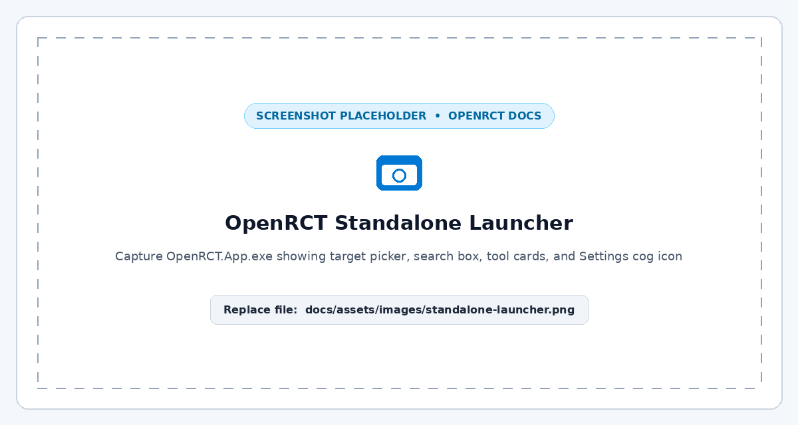

# OpenRCT — Open Source Right Click Tools for Microsoft Configuration Manager (MECM)

[](https://github.com/Snuffypot11/OpenRCT/actions/workflows/build-release.yml)
[](https://github.com/Snuffypot11/OpenRCT/actions/workflows/docs.yml)
[](LICENSE)

**OpenRCT** is a free, MIT-licensed, ad-free suite of **Right Click Tools** and **embedded console dashboards** for **Microsoft Configuration Manager (MECM / SCCM)**. Manage **single devices, multiple selected devices simultaneously, or entire Device Collections** directly inside the MECM Admin Console or via the standalone launcher.

**[Read the Full Searchable Documentation](https://snuffypot11.github.io/OpenRCT/)** · **[Download Latest Release](https://github.com/Snuffypot11/OpenRCT/releases/latest)** · **[Hyper-V MECM Lab Setup Guide](docs/lab-setup/README.md)**


---

## Transparency: AI-Assisted Development

> **OpenRCT was developed with substantial AI coding assistance** under human product direction, architectural guidance, and hands-on testing in a live Microsoft Configuration Manager test lab.
>
> All source code is 100% open under the [MIT License](LICENSE) for full inspection, auditing, and community contributions. As with any systems management tool, please review the code and validate in a test lab or pilot collection before deploying to production.

---

## Key Design Goals

- **100% Open Source & Ad-Free** — No paid tiers, trial prompts, telemetry, or licensing gates.
- **Zero Extra Runtime Prerequisites** — Pure **C# / WPF on .NET Framework 4.8**, the exact runtime already required by the MECM Admin Console.
- **Zero Mandatory External Dependencies** — Uses native Windows and ConfigMgr interfaces (WMI/DCOM, WinRM/CIM, SMB, LDAP/ADSI, SMS Provider, Remote Registry, EventLogSession, Wake-on-LAN). No proprietary Microsoft SDK DLLs are committed.
- **Optional PsExec Support** — Only *Remote Tools → Interactive Command Prompt* optionally uses user-supplied Sysinternals **PsExec** (configured in **OpenRCT Settings**).
- **Multi-Device Expandable UI** — Concurrent execution across 1..N devices or collections with item-first expandable grouping, synced checkboxes, resizable scrollable grids, collapsible Error Drawer, and CSV export.
- **Themes & Dual Vector Icon Sets** — **Light / Dark / System** themes plus switchable **Fluent Duotone** *(default)* and **Crisp Monochrome Outline** icons across both WPF windows and the MECM Admin Console tree/context menus.
- **Fork-Friendly Manual Updates** — Optional, manual-only GitHub Releases update check automatically bound to the CI repository (`GITHUB_REPOSITORY`) or user override — never phones home automatically and never hardcodes a personal repo.

---

## Included Tools & Dashboards

### Right-Click Context Menu (`OpenRCT` — 6 Organized Groups)


1. **Remote Tools**
   - **System Information** *(Multi-Device & Collection)* — 10 tabs (Operating Systems, Hardware, Disks, Applications with safe Remote Registry enumeration & uninstall, Windows Updates, Services control, Drivers, User Profiles with delete, Local Group Members, Batteries).
   - **Remote Software Center** *(Multi-Device & Collection)* — Applications, Software Updates, Task Sequences, and **Compliance Baselines** (`root\ccm\dcm`) with bulk Install/Uninstall/Repair/Run/Evaluate.
   - **Remote Windows Security** *(Multi-Device & Collection)* — 8 tabs: **BitLocker** (Suspend/Resume/Keys), **TPM** (status & Clear TPM), **Firmware** (UEFI, Secure Boot & **2023 CA Certificate** readiness + Update Task), **Virtualization-Based Security** (VBS, Credential Guard, HVCI), **Defender** (status + Quick/Full Scan & Update Definitions), **Defender Exclusions**, **Windows Firewall**, and **Firewall Rules** (Enable/Disable).
   - **Remote Event Viewer** — Split-pane viewer matching Remote Registry style with hierarchical Windows + Applications & Services log tree, auto-applying server-side XPath filters, pagination, General/XML detail pane, and CSV export.
   - **Remote Registry Editor** — Native remote registry browser with search and value inspection.
   - **Running Processes** *(Multi-Device & Collection)*, **Open `C$` Share**, **Interactive PowerShell Prompt (WinRM)**, **Interactive Command Prompt *(optional PsExec)***, and **Manage Computer**.
2. **Client Actions (12)** — Application Deployment Evaluation, Discovery Data Collection, File Collection, Hardware Inventory, Machine Policy Retrieval & Evaluation, Send Unsent State Messages, Software Inventory, Software Metering Usage Report, Software Updates Deployment Evaluation, Software Updates Scan, State Message Cache Cleanup, and Windows Installer Source List Update.
3. **Client Tools** — **Client Information** *(Multi-Device & Collection: Details, Components, Cache Manager)*, Show Collections - Advanced *(with Maintenance Windows)*, Rerun Deployment, Refresh Updates Compliance State, Restart SMS Agent Host Service, Run Client Check, Stop Client Activities, Repair Client, Uninstall SCCM Client, Open Client Log Folder, and Open Client Installation Log Folder.
4. **Device & Power Tools** — Ping Systems, Wake on LAN, Send Notification, Schedule Restart or Shutdown *(immediate or scheduled with custom notice)*, Cancel Pending Restart/Shutdown, and Group Policy Update.
5. **Security Tools** — View LAPS Password *(Legacy & Windows LAPS)*, View BitLocker Recovery Key *(AD & ConfigMgr)*, Windows Defender Quick Scan, Full Scan, and Update Definitions.
6. **Active Directory & ConfigMgr** — AD Security Groups, Enable/Disable/Delete Device(s) in AD, Add Device(s) to Collection, Delete Device(s) from ConfigMgr, and Device Status Messages.
- **OpenRCT Settings** — PsExec path browser & validator, transport/concurrency/timeout settings, Light/Dark/System theme, **Icon Style** (`Fluent Duotone` / `Crisp Monochrome Outline` with MECM Console sync), safety controls, and manual GitHub Releases update check.

### Embedded Console Dashboards (*Assets and Compliance → Overview → OpenRCT*)
All 6 dashboards live directly under **OpenRCT** in the MECM Console (and in the standalone app):

1. **Active Directory Cleanup Tool** — Compares AD OUs against ConfigMgr Collections with interactive pie chart (`ConfigMgr`, `Both`, `Active Directory`), 15-column grid, cleanup actions, error drawer, and CSV export.
2. **BitLocker Compliance** — Audits on-premises BitLocker recovery key storage in AD & ConfigMgr alongside encryption and compliance status with two interactive pie charts, OU/Collection toggle, error drawer, and CSV export.
3. **Content Distribution Monitor** — Interactive Distribution Point stacked bar chart, DP properties inspector, content grid, **Content Status** dialog, **Redistribute**, **Validate**, **Remove from DP**, and bulk **Redistribute Failed Content Transfers**.
4. **Hardware and Firmware Audit** — Audits chassis, manufacturer, model, UEFI, Secure Boot, TPM, BIOS, and OS versions across collections with customizable **Select Charts** picker, **Nested Filtering**, error drawer, and CSV export.
5. **LAPS Dashboard** — Audits both Legacy Microsoft LAPS and Windows LAPS passwords & client install state with two interactive pie charts, 8-column grid, error drawer, and CSV export.
6. **Software Updates Deployment Status** — Analyzes collection update compliance with deployed-only toggle, Software Update Group filter, age slider, 6 classification checkboxes, `Device Compliance Status` & `Missing Updates By Category` pie charts, remediation actions, and CSV export.

### Standalone Launcher (`OpenRCT.App.exe`)



Target manual devices or MECM Device Collections, search all tools and dashboards, check for updates manually, and configure settings directly outside the MECM Admin Console.

---

## Installation

### Prerequisite (Required for MECM 2103 and newer)
Before installing or launching OpenRCT inside the MECM Admin Console:

1. Open the Configuration Manager Console and go to **Administration → Site Configuration → Sites**.
2. Click **Hierarchy Settings** in the top ribbon.
3. On the **General** tab, **uncheck** **`Only allow console extensions that are approved for the hierarchy`**.
4. Click **OK**, install OpenRCT, and **restart the Configuration Manager Console**.

### Option 1: MSI Installer (Recommended)
Download `OpenRCT.msi` from [GitHub Releases](https://github.com/Snuffypot11/OpenRCT/releases) and run interactively, or silently:

```powershell
msiexec /i OpenRCT.msi /qn
# Optional: pre-configure Sysinternals PsExec path
msiexec /i OpenRCT.msi /qn PSEXECPATH="C:\Tools\PsExec64.exe"
```

### Option 2: Portable ZIP + PowerShell Script
Extract `OpenRCT-portable.zip` and run from an elevated PowerShell prompt:

```powershell
.\scripts\Install-OpenRCT.ps1
# Optional: specify PsExec path or Crisp Monochrome Outline console icons
.\scripts\Install-OpenRCT.ps1 -PsExecPath "C:\Tools\PsExec64.exe" -IconStyle Outline
```

Restart the Configuration Manager Console to load the right-click menus and dashboard nodes under **Assets and Compliance → Overview → OpenRCT**. Full installer diagnostics are written to `C:\ProgramData\OpenRCT\install.log`.

### Uninstalling
Uninstall via **Settings → Apps → Installed Apps** (MSI) or run:

```powershell
& "C:\Program Files\OpenRCT\scripts\Uninstall-OpenRCT.ps1"
```

---

## Documentation & Lab Setup

- **Full Searchable Documentation:** Hosted on GitHub Pages at [snuffypot11.github.io/OpenRCT](https://snuffypot11.github.io/OpenRCT/) (built from `docs/` via MkDocs Material).
- **Hyper-V MECM Test Lab:** Automated 4-VM Hyper-V lab setup guide (`LAB-DC01`, `LAB-CM01`, `LAB-WS01`, `LAB-WS02`) in [docs/lab-setup/README.md](docs/lab-setup/README.md).
- **Adding Screenshots:** See [docs/assets/images/README.md](docs/assets/images/README.md) for the drop-in screenshot placeholder inventory.

---

## Building from Source

### On Windows (Full Build + Dual Icon DLLs + WPF + WiX v4 MSI)
Requires .NET 8 SDK (or Visual Studio 2022 with the *.NET desktop development* workload):

```powershell
.\installer\scripts\Build-IconsDll.ps1 -IconsDir "src\OpenRCT.Icons\Icons" -OutputDll "src\OpenRCT.Icons\bin\Release\net48\OpenRCT.Icons.Duotone.dll" -Version "0.2.5.0"
.\installer\scripts\Build-IconsDll.ps1 -IconsDir "src\OpenRCT.Icons\IconsOutline" -OutputDll "src\OpenRCT.Icons\bin\Release\net48\OpenRCT.Icons.Outline.dll" -Version "0.2.5.0"
dotnet build OpenRCT.sln -c Release
dotnet test tests/OpenRCT.Tests/OpenRCT.Tests.csproj -c Release
dotnet build installer/OpenRCT.Installer/OpenRCT.Installer.wixproj -c Release
```

### On Linux / macOS (Core, Connectors & Automated Tests)
```bash
dotnet build src/OpenRCT.Core/OpenRCT.Core.csproj -c Release
dotnet build src/OpenRCT.Connectors/OpenRCT.Connectors.csproj -c Release
dotnet test tests/OpenRCT.Tests/OpenRCT.Tests.csproj --framework net8.0 -c Release
```

---

## License

Licensed under the [MIT License](LICENSE).