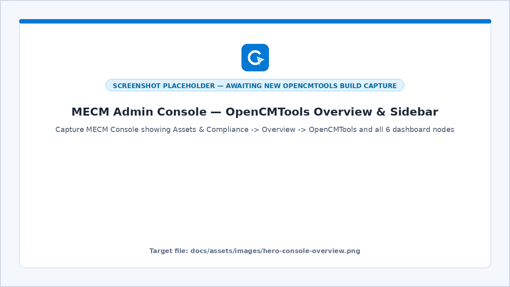
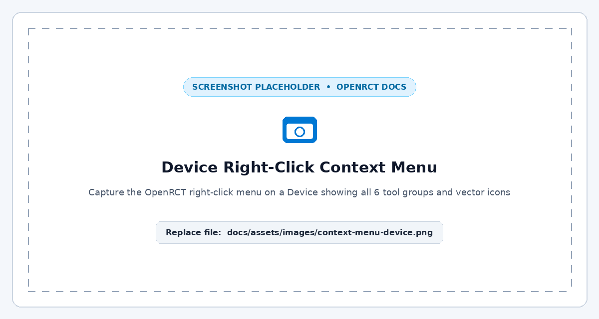

# OpenCMTools — Open Source Endpoint & Console Tools for Microsoft Configuration Manager (MECM)

[](https://github.com/Snuffypot11/OpenCMTools/actions/workflows/build-release.yml)
[](https://github.com/Snuffypot11/OpenCMTools/actions/workflows/docs.yml)
[](LICENSE)

**OpenCMTools** is a free, MIT-licensed, ad-free suite of **endpoint management tools** and **embedded console dashboards** for **Microsoft Configuration Manager (MECM / SCCM)**. Manage **single devices, multiple selected devices simultaneously, or entire Device Collections** directly inside the MECM Admin Console or via the standalone launcher.

**[Read the Full Searchable Documentation](https://snuffypot11.github.io/OpenCMTools/)** · **[Download Latest Release](https://github.com/Snuffypot11/OpenCMTools/releases/latest)** · **[Hyper-V MECM Lab Setup Guide](docs/lab-setup/README.md)**



---

## Transparency: AI-Assisted Development

> **OpenCMTools was developed with substantial AI coding assistance** under human product direction, architectural guidance, and hands-on testing in a live Microsoft Configuration Manager test lab.
>
> All source code is 100% open under the [MIT License](LICENSE) for full inspection, auditing, and community contributions. As with any systems management tool, please review the code and validate in a test lab or pilot collection before deploying to production.

---

## Key Design Goals

- **100% Open Source & Ad-Free** — No paid tiers, trial prompts, telemetry, or licensing gates.
- **Zero Extra Runtime Prerequisites** — Pure **C# / WPF on .NET Framework 4.8**, the exact runtime already required by the MECM Admin Console.
- **Zero Mandatory External Dependencies** — Uses native Windows and ConfigMgr interfaces (WMI/DCOM, WinRM for Interactive PowerShell, SMB, LDAP/ADSI, SMS Provider, Remote Registry, EventLogSession, Wake-on-LAN). No proprietary Microsoft SDK DLLs are committed.
- **Optional PsExec Support** — Only *Remote Tools → Interactive Command Prompt* optionally uses user-supplied Sysinternals **PsExec** (configured in **OpenCMTools Settings**).
- **Multi-Device Expandable UI** — Concurrent execution across 1..N devices or collections with item-first expandable grouping, synced checkboxes, resizable scrollable grids, collapsible Error Drawer, and CSV export.
- **Themes & Dual Vector Icon Sets** — **Light / Dark / System** themes plus switchable **Fluent Duotone** *(default)* and **Crisp Monochrome Outline** icons across both WPF windows and the MECM Admin Console tree/context menus.
- **Fork-Friendly Manual Updates** — Optional, manual-only GitHub Releases update check automatically bound to the CI repository (`GITHUB_REPOSITORY`) or user override — never phones home automatically and never hardcodes a personal repo.

---

## Included Tools & Dashboards

### Endpoint Tools Context Menu (`OpenCMTools` — 6 Organized Groups)



1. **Remote Tools (10)**
   - **System Information** *(Multi-Device & Collection)* — 10 tabs (Operating Systems, Hardware, Disks, Applications with safe Remote Registry enumeration & uninstall, Windows Updates, Services control, Drivers, User Profiles with delete, Local Group Members, Batteries).
   - **Remote Software Center** *(Multi-Device & Collection)* — 4 tabs (Applications, Software Updates, Task Sequences, and Compliance Baselines via `root\ccm\dcm`) with bulk Install/Uninstall/Repair/Run/Evaluate.
   - **Remote Windows Security** *(Multi-Device & Collection)* — 8 tabs (BitLocker with Suspend/Resume/Keys, TPM status & Clear TPM, Firmware for UEFI, Secure Boot & 2023 CA Certificate readiness + Update Task, Virtualization-Based Security for VBS, Credential Guard & HVCI, Defender status + Quick/Full Scan & Update Definitions, Defender Exclusions, Windows Firewall, and Firewall Rules with Enable/Disable).
   - **Remote Event Viewer** — Split-pane viewer matching Remote Registry style with hierarchical Windows + Applications & Services log tree, auto-applying XPath + client-side filters, pagination, General/XML detail pane, and CSV export.
   - **Remote Registry Editor** — Native remote registry explorer (`HKLM`, `HKU`, `HKCR`, `HKCC`) with path jump bar, value inspection, Set/Delete Value, and one-click `RemoteRegistry` service start.
   - **Running Processes** *(Multi-Device & Collection)*, **Connect to `C$`** *(single device)*, **Interactive PowerShell Prompt (WinRM)** *(single device)*, **Interactive Command Prompt** *(optional PsExec, single device)*, and **Manage Computer** *(single device)*.
2. **Client Actions (12)** — Application Deployment Evaluation Cycle, Discovery Data Collection Cycle, File Collection Cycle, Hardware Inventory Cycle, Machine Policy Retrieval and Evaluation Cycle, Send Unsent State Messages, Software Inventory Cycle, Software Metering Usage Report Cycle, Software Updates Deployment Evaluation Cycle, Software Updates Scan Cycle, State Message Cache Cleanup, and Windows Installer Source List Update Cycle.
3. **Client Tools (13)** — **Client Information** *(Multi-Device & Collection: Details, Components, Cache)*, Show Collections - Advanced *(with Maintenance Windows)*, Add Device(s) to Collection, Device Status Messages, Open Client Log File Folder, Open Client Installation Log File Folder, Refresh Updates Compliance State, Rerun Deployment, Restart SMS Agent Host Service, Run Client Check, Stop ConfigMgr Client Activities, Repair Client, and Uninstall SCCM Client.
4. **Device and Power Tools (6)** — Ping System(s), Wake On LAN, Group Policy Update, Send Notification, Schedule Restart or Shutdown *(immediate or scheduled with custom notice)*, and Cancel Pending Restart or Shutdown.
5. **Security Tools (5)** — View LAPS Password *(Legacy & Windows LAPS)*, View BitLocker Recovery Key *(AD & ConfigMgr)*, Windows Defender - Quick Scan, Full Scan, and Update Definitions.
6. **Active Directory and ConfigMgr (5)** — AD Security Groups, Enable/Disable/Delete Device(s) in Active Directory, and Delete Device(s) From ConfigMgr.
- **OpenCMTools Settings** — PsExec path browser & validator, concurrency/timeout/fast-offline settings, Light/Dark/System theme, **Icon Style** (`Fluent Duotone` / `Crisp Monochrome Outline` with MECM Console sync), safety controls, and manual GitHub Releases update check.

### Embedded Console Dashboards (*Assets and Compliance → Overview → OpenCMTools*)
All 6 dashboards live directly under **OpenCMTools** in the MECM Console (and in the standalone app):

1. **Active Directory Cleanup Tool** — Compares AD OUs against ConfigMgr Collections with interactive pie chart (`ConfigMgr`, `Both`, `Active Directory`), 15-column grid, cleanup actions, error drawer, and CSV export.
2. **BitLocker Compliance** — Audits on-premises BitLocker recovery key storage in AD & ConfigMgr alongside encryption and compliance status with two interactive pie charts, OU/Collection toggle, error drawer, and CSV export.
3. **Content Distribution Monitor** — Interactive Distribution Point stacked bar chart, DP properties inspector, content grid, **Content Status** dialog, **Redistribute**, **Validate**, **Remove from DP**, and bulk **Redistribute Failed Content Transfers**.
4. **Hardware and Firmware Audit** — Audits chassis, manufacturer, model, UEFI, Secure Boot, TPM, BIOS, and OS versions across collections with customizable **Select Charts** picker, **Nested Filtering**, error drawer, and CSV export.
5. **LAPS Dashboard** — Audits both Legacy Microsoft LAPS and Windows LAPS passwords & client install state with two interactive pie charts, 8-column grid, error drawer, and CSV export.
6. **Software Updates Deployment Status** — Analyzes collection update compliance with deployed-only toggle, Software Update Group filter, age slider, 6 classification checkboxes, `Device Compliance Status` & `Missing Updates By Category` pie charts, remediation actions, and CSV export.

### Standalone Launcher (`OpenCMTools.App.exe`)


Target manual devices or MECM Device Collections, search all 51 endpoint tools, launch any of the 6 dashboards, check for updates manually, and configure settings directly outside the MECM Admin Console.

---

## Installation

### Prerequisite (Required for MECM 2103 and newer)
Before installing or launching OpenCMTools inside the MECM Admin Console:

1. Open the Configuration Manager Console and go to **Administration → Site Configuration → Sites**.
2. Click **Hierarchy Settings** in the top ribbon.
3. On the **General** tab, **uncheck** **`Only allow console extensions that are approved for the hierarchy`**.
4. Click **OK**, install OpenCMTools, and **restart the Configuration Manager Console**.

### Option 1: MSI Installer (Recommended)
Download `OpenCMTools.msi` from [GitHub Releases](https://github.com/Snuffypot11/OpenCMTools/releases) and run interactively, or silently:

```powershell
msiexec /i OpenCMTools.msi /qn
# Optional: pre-configure Sysinternals PsExec path
msiexec /i OpenCMTools.msi /qn PSEXECPATH="C:\Tools\PsExec64.exe"
```

### Option 2: Portable ZIP + PowerShell Script
Extract `OpenCMTools-portable.zip` and run from an elevated PowerShell prompt:

```powershell
.\scripts\Install-OpenCMTools.ps1
# Optional: specify PsExec path or Crisp Monochrome Outline console icons
.\scripts\Install-OpenCMTools.ps1 -PsExecPath "C:\Tools\PsExec64.exe" -IconStyle Outline
```

Restart the Configuration Manager Console to load the right-click menus and dashboard nodes under **Assets and Compliance → Overview → OpenCMTools**. Full installer diagnostics are written to `C:\ProgramData\OpenCMTools\install.log`.

### Uninstalling
Uninstall via **Settings → Apps → Installed Apps** (MSI) or run:

```powershell
& "C:\Program Files\OpenCMTools\scripts\Uninstall-OpenCMTools.ps1"
```

---

## Documentation & Lab Setup

- **Full Searchable Documentation:** Hosted on GitHub Pages at [snuffypot11.github.io/OpenCMTools](https://snuffypot11.github.io/OpenCMTools/) (built from `docs/` via MkDocs Material).
- **Hyper-V MECM Test Lab:** Automated 4-VM Hyper-V lab setup guide (`LAB-DC01`, `LAB-CM01`, `LAB-WS01`, `LAB-WS02`) in [docs/lab-setup/README.md](docs/lab-setup/README.md).
- **Updating Screenshots:** See [docs/assets/images/README.md](docs/assets/images/README.md) for the documentation screenshot inventory.

---

## Building from Source

### On Windows (Full Build + Dual Icon DLLs + WPF + WiX v4 MSI)
Requires .NET 8 SDK (or Visual Studio 2022 with the *.NET desktop development* workload):

```powershell
.\installer\scripts\Build-IconsDll.ps1 -IconsDir "src\OpenCMTools.Icons\Icons" -OutputDll "src\OpenCMTools.Icons\bin\Release\net48\OpenCMTools.Icons.Duotone.dll"
.\installer\scripts\Build-IconsDll.ps1 -IconsDir "src\OpenCMTools.Icons\IconsOutline" -OutputDll "src\OpenCMTools.Icons\bin\Release\net48\OpenCMTools.Icons.Outline.dll"
dotnet build OpenCMTools.sln -c Release
dotnet test tests/OpenCMTools.Tests/OpenCMTools.Tests.csproj -c Release
dotnet build installer/OpenCMTools.Installer/OpenCMTools.Installer.wixproj -c Release
```

### On Linux / macOS (Core, Connectors & Automated Tests)
```bash
dotnet build src/OpenCMTools.Core/OpenCMTools.Core.csproj -c Release
dotnet build src/OpenCMTools.Connectors/OpenCMTools.Connectors.csproj -c Release
dotnet test tests/OpenCMTools.Tests/OpenCMTools.Tests.csproj --framework net8.0 -c Release
```

---

## License

Licensed under the [MIT License](LICENSE).