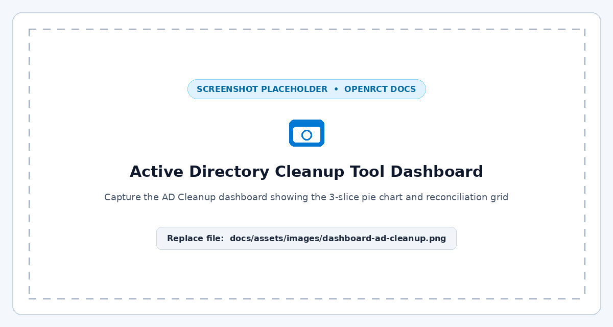

# Active Directory Cleanup Tool

Reconcile **Active Directory** Organizational Units against **Configuration Manager** Device Collections to spot stale, decommissioned, or unmanaged devices at a glance.

---

## How to Use

1. Select one or more **Active Directory OUs** (sub-OUs are included automatically; leave blank for the entire domain) and one or more **ConfigMgr Device Collections** (leave blank for all devices).
2. Click **Scan** to reconcile computer accounts from both sources.
3. Click any slice of the interactive pie chart to filter the 15-column results table:
   - **Both:** Device exists in both Active Directory and Configuration Manager.
   - **Active Directory:** Computer object exists in AD but has no ConfigMgr record (often stale or missing the MECM client).
   - **ConfigMgr:** Resource exists in ConfigMgr but has no matching AD computer object in the selected OU(s).

---

## Built-In Cleanup Actions & Export

Right-click one or more rows in the grid to:

- **Delete Selected from Active Directory** *(with confirmation)*
- **Delete Selected from ConfigMgr** *(with confirmation)*
- **Ping System(s)** or **Open System Information**

Click **Export to CSV** in the bottom bar to save the reconciliation report for change-control review.
