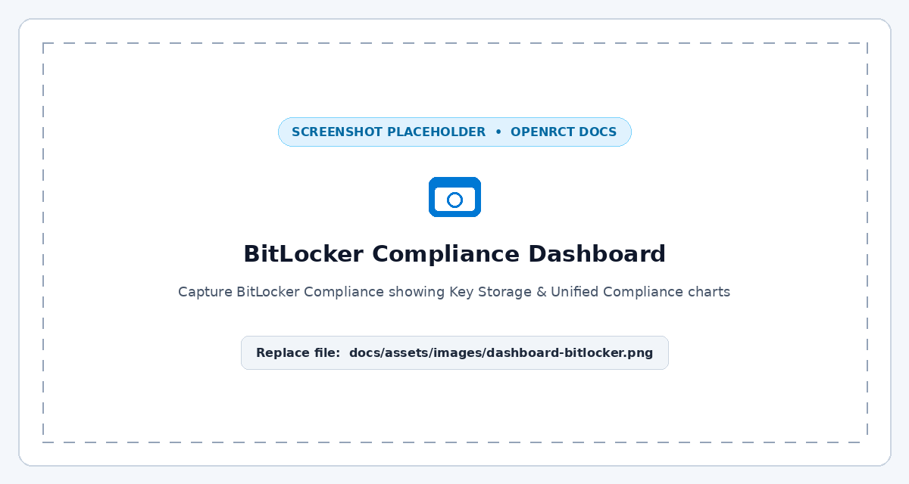

# BitLocker Compliance Dashboard

Audit on-premises **BitLocker** recovery key escrow and volume compliance across **Active Directory** and **Configuration Manager** (strictly on-premises — no Entra ID / Intune dependencies).

---

## How to Use

1. Choose your scope mode:
   - **Active Directory OU** *(with optional Sub-OU recursion)*, or
   - **ConfigMgr Device Collection**
2. Click **Scan** to query `msFVE-RecoveryInformation` objects in Active Directory and ConfigMgr BitLocker inventory (`SMS_G_System_ENCRYPTABLE_VOLUME` / `SMS_BitLockerRecoveryKey`).

---

## Interactive Charts

- **BitLocker Recovery Key Storage:** Breaks down devices by where recovery keys are backed up (`AD & ConfigMgr`, `Active Directory Only`, `ConfigMgr Only`, `No Key Found`).
- **Unified Compliance:** Breaks down encryption/protection compliance (`Compliant`, `Non-Compliant`, `Unknown`).

Click any slice on either chart to filter the device grid.

---

## Row Actions

Right-click any device row to:

- **View BitLocker Recovery Key** (with copy + auto-clear clipboard)
- **Open Remote Windows Security** (suspend/resume BitLocker, inspect TPM & Secure Boot)
- **Trigger Hardware Inventory Cycle** or **Machine Policy Retrieval & Evaluation Cycle**
- **Export CSV** for audit reporting.
