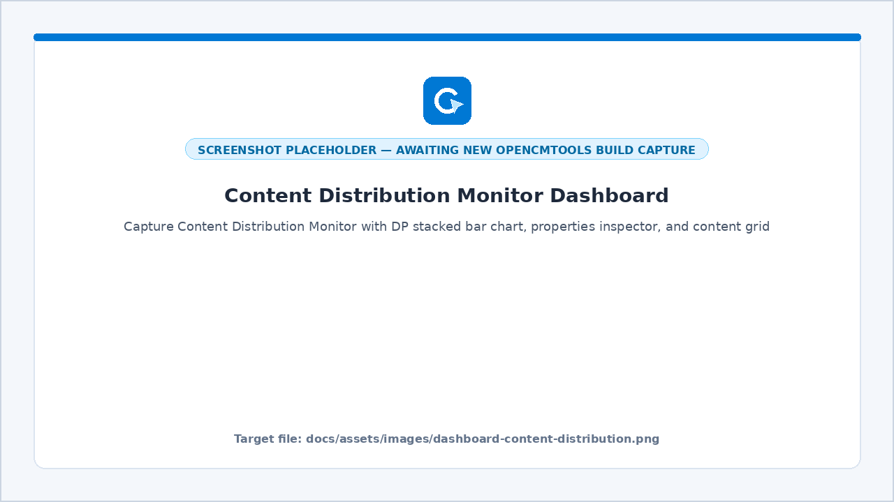

# Content Distribution Monitor

Monitor **Distribution Point (DP)** health across your ConfigMgr hierarchy, inspect failed or in-progress content transfers, and remediate packages directly from the dashboard.

---

## Dashboard Layout

1. **Interactive Distribution Point Stacked Bar Chart (`Global Distribution Status`):** Displays every Distribution Point with color-coded counts for **Success**, **In Progress**, and **Error** content items. Click any DP bar to focus the properties inspector and content table on that DP (click **Show All DPs** to reset).
2. **DP Properties Inspector:** Displays the selected Distribution Point's `Description`, `HTTPS Enabled`, `LEDBAT Enabled`, `Internet Facing`, `Multicast Enabled`, `Peer DP`, `Pull DP`, `Maintenance Mode`, `PXE Enabled`, and `Percent Free Space`.
3. **Filterable Content Grid:** Filter by **Status** (`All`, `Error`, `In Progress`, `Success`) or search by Content Name, Package ID, Object ID, Distribution Point, or Description (`Type` is displayed as a sortable column across Applications, Packages, Boot Images, OS Images, OS Install Packages, Driver Packages, Device Setting Packages, and Software Update Packages).

---

## Built-In Content Actions

Select one or more content rows (or right-click a row) to perform native SMS Provider operations:

| Action | Underlying SMS Provider Call | What It Does |
|---|---|---|
| **Content Status** | Queries `SMS_DistributionDPStatus` | Opens a detailed **Content Status** dialog listing every Distribution Point holding that package, its site, state, message ID, last status time, and summary — with **Refresh**, **Redistribute Selected**, and **Validate Selected** buttons |
| **Redistribute Content to DP** | Sets `RefreshNow = true` on `SMS_DistributionPoint` | Forces the Distribution Manager to re-send content to the selected DP |
| **Validate Content on DP** | Calls static `SMS_DistributionPoint.VerifyPackage(PackageId, NALPath)` | Schedules content integrity hash verification on the selected DP |
| **Remove Content from DP** | Deletes the `SMS_DistributionPoint` association *(with confirmation)* | Removes the package from the selected Distribution Point |
| **Redistribute Failed Content Transfers** | Bulk `RefreshNow = true` across all `Error` DP rows *(with confirmation)* | Bulk remediation for all failed transfers on the selected DP (or across all DPs if none is selected) |

Every action logs progress and errors cleanly, and the bottom bar includes **Export to CSV** for the content table.
