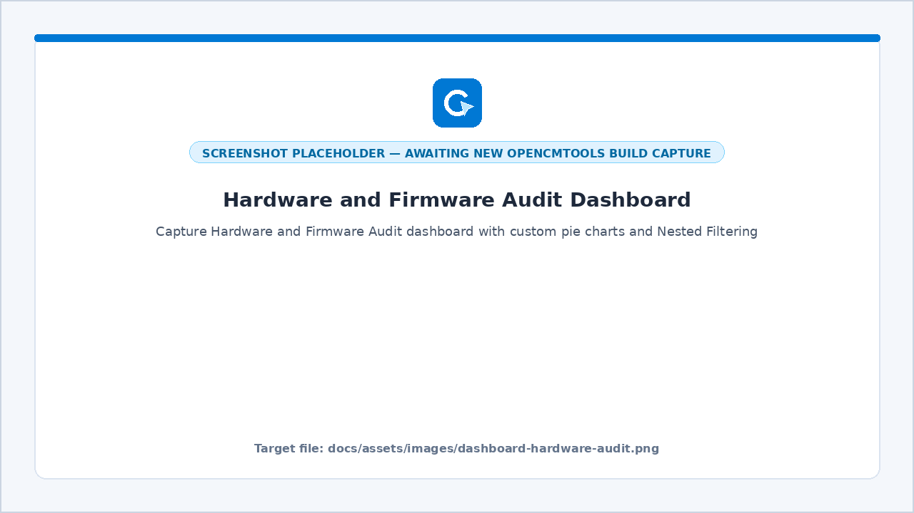

# Hardware and Firmware Audit Dashboard

Audit hardware models, chassis types, UEFI, Secure Boot, TPM, BIOS versions, and OS builds across any **ConfigMgr Device Collection** — ideal for Windows 11 readiness, BIOS upgrade campaigns, and Secure Boot / TPM audits.

---

## Customizable Charts & Nested Filtering

1. Select one or more **Device Collections** (or leave blank for all devices) and click **Scan** to query ConfigMgr hardware inventory (`SMS_G_System_COMPUTER_SYSTEM`, `SMS_G_System_SYSTEM_ENCLOSURE`, `SMS_G_System_PC_BIOS`, `SMS_G_System_FIRMWARE`, `SMS_G_System_TPM`, `SMS_G_System_OPERATING_SYSTEM`).
2. Click **Select Charts** to choose which pie charts are displayed (up to 8 dimensions; defaults to `Chassis`, `Manufacturer`, and `Model`):
   - **Chassis** (`VirtualMachine`, `Laptop`, `Tablet`, `AllInOne`, `Desktop`, `Server`, `Unknown`)
   - **Manufacturer**
   - **Model**
   - **UEFI Status**
   - **Secure Boot Status**
   - **TPM Status**
   - **BIOS Version**
   - **OS Version**
3. **Single vs Nested Filtering:**
   - By default, clicking a slice filters the device table to that single attribute.
   - Check **Nested Filtering** to stack filters cumulatively across multiple charts (for example: `Chassis = Laptop` → `Manufacturer = Dell` → `Secure Boot Status = Disabled`), shown as an active filter summary in the bottom status bar with a **Clear Filters** reset button in the toolbar.

---

## Row Actions & Export

Right-click one or more rows in the grid to:

- Open **System Information** or **Client Information**
- Trigger **Hardware Inventory Cycle** or **Ping System(s)**

Click **Export to CSV** in the bottom bar to export the filtered inventory slice.
