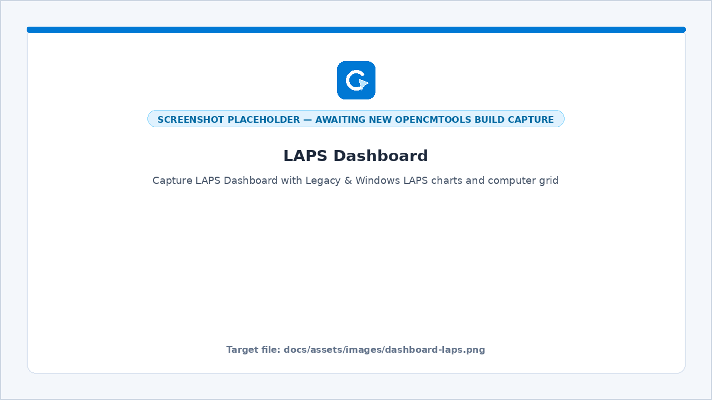

# LAPS Dashboard

Track local administrator password management coverage across **both Legacy Microsoft LAPS and built-in Windows LAPS** without requiring any RSAT PowerShell modules.

---

## How to Use

1. Select one or more **Active Directory OUs** (sub-OUs are included automatically; leave blank for the entire domain) and click **Scan**.
2. Inspect the two interactive pie charts:
   - **LAPS Password in AD:** `Computers with LAPS Password` vs `Computers without LAPS Password`.
   - **LAPS Client Install State:** `Computers with x64 LAPS Client Installed`, `Computers with x86 LAPS Client Installed`, `Computers with Windows Built-in LAPS` *(shown when present)*, and `No LAPS Client Installed`.
3. Click any pie slice to filter the 8-column results table (`Name`, `Distinguished Name`, `Password Last Set`, `OS`, `OS Version`, `LAPS Password Expiration`, `Laps Client Install State`, `Created`).

---

## Row Actions & Export

Right-click any device row to:

- **View LAPS Password** (masked reveal + copy with automatic clipboard clear; detects encrypted Windows LAPS)
- **Open System Information**

Click **Export to CSV** in the bottom bar to save the report.
