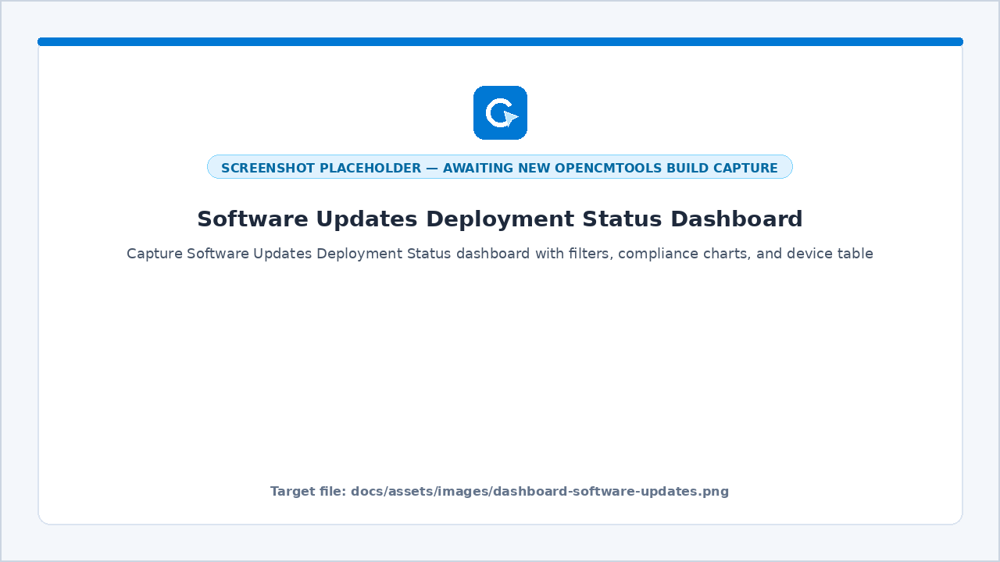

# Software Updates Deployment Status Dashboard

Analyze patch compliance across any **ConfigMgr Device Collection** with flexible filtering by deployment status, Software Update Group, update age, and classification.

!!! info "Data Source"
    This dashboard queries **MECM directly via the SMS Provider** (`SMS_SoftwareUpdate`, `SMS_AuthorizationList`, `SMS_CIRelation`, and batched collection-scoped `SMS_UpdateComplianceStatus` queries for Required/Installed states) — it does **not** connect to individual client devices during the scan.

---

## Filters

- **Device Collection:** Target any ConfigMgr collection.
- **Limit to Deployed Updates *(Checked by default)*:** Pushes `IsDeployed = 1` filtering down to MECM SQL Server for fast production scans; uncheck and click **Start** to query the full non-expired catalog.
- **Software Update Group (SUG) Filter:** Filter compliance calculations to one or more specific SUGs.
- **Age Slider:** Filter out brand-new updates (e.g., show missing updates older than 7, 14, or 30 days).
- **6 Update Classification Checkboxes:** `Security Updates`, `Critical Updates`, `Update Rollups`, `Updates`, `Feature Packs`, `Service Packs`.

---

## Interactive Charts & Remediation

- **Device Compliance Status:** `Compliant`, `Non-Compliant`, `Unknown`.
- **Missing Updates by Category:** Visual breakdown of missing updates by classification.

Click any chart slice to filter the device grid, then right-click rows to:

- Open **Remote Software Center** to inspect and install missing updates immediately
- Trigger **Software Updates Scan Cycle**, **Software Updates Deployment Evaluation Cycle**, or **Refresh Updates Compliance State**
- **Schedule Restart** for devices pending reboot
- **Export CSV** for compliance reporting.
