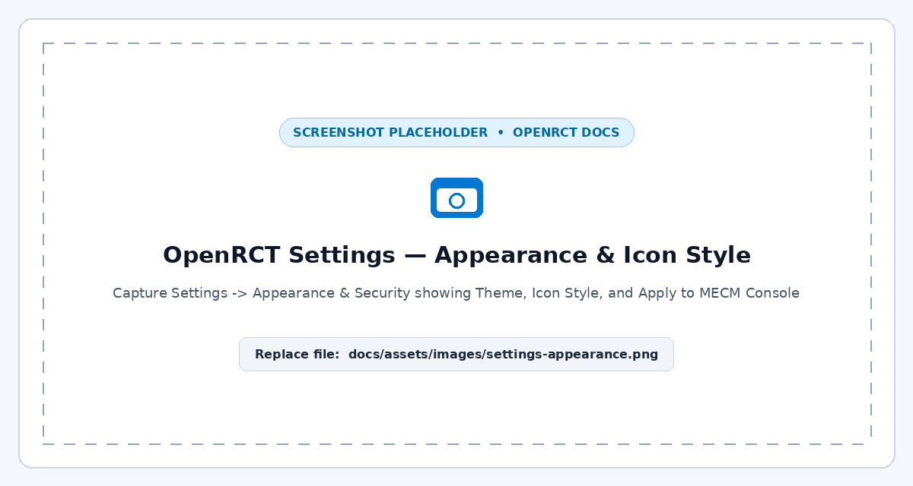

# Settings & Customization

Open **OpenRCT Settings** from the **Settings (Cog)** button in the standalone app, or from **Right-Click → OpenRCT → OpenRCT Settings** inside the MECM Admin Console.

Settings are stored per-user as plain JSON in:

```text
%AppData%\OpenRCT\settings.json
```



---

## 1. External Tools (Optional PsExec)

OpenRCT has **zero mandatory external dependencies**. Sysinternals **PsExec** is only needed if you want to use **Remote Tools → Interactive Command Prompt**.

- **Path to PsExec.exe or PsExec64.exe:** Click **Browse...** to select your local copy of Sysinternals PsExec. Live validation confirms the file exists and warns if the filename does not match `PsExec*.exe`.
- **Run Interactive Command Prompt as Local SYSTEM (`-s`):** Passes `-s` to PsExec (enabled by default).
- **Automatically pass `-accepteula`:** Suppresses the first-run Sysinternals EULA dialog.
- **Additional PsExec Arguments:** Optional extra CLI flags appended before `cmd.exe`.

---

## 2. Connections & Performance

Tune how OpenRCT communicates with remote endpoints and your MECM SMS Provider:

| Setting | Default | Range / Options | Description |
|---|---|---|---|
| **Preferred Remote Transport** | `WmiDcomFirst` | `WmiDcomFirst`, `WinRmCimFirst`, `WmiDcomOnly`, `WinRmCimOnly` | Controls whether remote queries prefer classic WMI/DCOM or WinRM/CIM |
| **Connection Timeout (seconds)** | `15` | `3` – `300` | Per-device timeout for remote operations |
| **Max Concurrent Devices** | `16` | `1` – `64` | Maximum number of devices queried in parallel during multi-device and collection operations |
| **Default SMS Provider Server** | *(auto-detect)* | Hostname / FQDN | Optional override if you manage multiple sites or run standalone without a local MECM Console |
| **Default Site Code** | *(auto-detect)* | 3-character site code | Optional MECM Site Code override (e.g., `LAB`, `P01`) |
| **Fast Offline Pre-Check** | Enabled (`true`) | Checkbox | Runs a fast ICMP Ping + RPC (`135`) / SMB (`445`) probe before WMI/Remote Registry queries so powered-off devices fail in ~1.5s instead of hanging on OS DCOM timeouts |
| **Offline Check Timeout (ms)** | `1500` | `300` – `10000` | Per-device timeout for the fast online reachability pre-check |

---

## 3. Appearance & Security

### UI Theme
Choose between:

- **Light** *(default — matches standard MECM Admin Console chrome)*
- **Dark** *(modern dark surfaces with high-contrast text and dark-adapted vector icons)*
- **System** *(automatically follows Windows Apps Light/Dark mode)*

### Icon Style (`Fluent Duotone` vs `Crisp Monochrome Outline`)
OpenRCT includes two complete vector icon sets (while keeping the primary blue Option B OpenRCT logo consistent in both styles):

- **Fluent Duotone (Default)** — Color-coded Fluent accents with soft translucent fills for quick visual scanning.
- **Crisp Monochrome Outline** — Minimal, high-contrast dark slate outline strokes (auto-inverting to light gray in Dark Mode for WPF windows).

#### How MECM Console Icon Sync Works
1. Changing **Icon Style** updates all open WPF windows (standalone launcher, tool windows, and embedded dashboards) **immediately**.
2. Clicking **Save** (or clicking **Apply to MECM Console**) also updates `<AdminConsole>\bin\OpenRCT.Icons.dll` by deploying `OpenRCT.Icons.Duotone.dll` or `OpenRCT.Icons.Outline.dll`:
   - If you are already running elevated, the swap happens silently (safely rotating `OpenRCT.Icons.dll` if the console currently has it locked).
   - If you are running as a standard user, OpenRCT asks for confirmation and triggers a single **Windows UAC prompt** to run the fast-path `Install-OpenRCT.ps1 -ApplyIconStyleOnly -IconStyle <Duotone|Outline>`.
3. **Restart the MECM Admin Console** once to see the updated tree, ribbon, and right-click menu icons.

!!! tip "Out-of-Sync Indicator"
    If `<AdminConsole>\bin\OpenRCT.Icons.dll` does not match your saved `IconStyle` (for example after an MSI upgrade), Settings displays an amber hint under **Icon Style** — click **Apply to MECM Console** at any time to re-sync.

### Safety Controls
- **Prompt for confirmation before destructive actions:** Prompts before *Delete*, *Uninstall*, *Clear TPM*, *Restart/Shutdown*, and *Remove Content*.
- **Automatically clear clipboard after copying secrets:** Clears the Windows clipboard automatically after copying **LAPS passwords** or **BitLocker recovery keys** (default: **30 seconds**, configurable `5`–`300` seconds).

---

## 4. Updates (Manual & Fork-Friendly)

OpenRCT **never phones home automatically in the background**.

- **Enable manual 'Check for Updates' button:** Uncheck this in air-gapped environments to hide the update check button in the standalone launcher.
- **GitHub Repository Override:** Accepts `owner/repo` or a full `https://github.com/owner/repo` URL.
  - When left blank, CI-built releases automatically check the repository from which they were compiled (embedded at build time via `GITHUB_REPOSITORY` in `Directory.Build.props`).
  - Forks and private mirrors automatically check their own releases without editing source code.
- **Check for Updates Now:** Queries the GitHub Releases API on demand, compares SemVer versions, shows release notes, and provides a button to open the release download page in your default browser.
