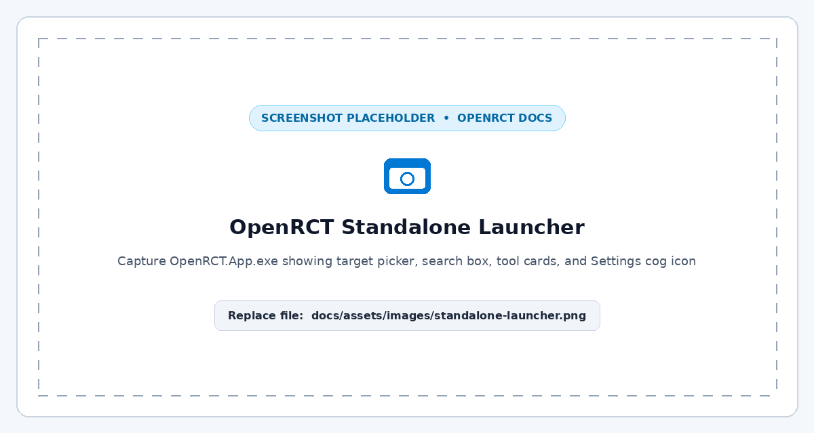

# Standalone App (`OpenRCT.App.exe`)

In addition to running directly inside the Configuration Manager Admin Console, OpenRCT ships with a full **Standalone Launcher** (`OpenRCT.App.exe`) available from the **Start Menu → OpenRCT**.

This is ideal when:

- You want to run bulk tools or dashboards without launching the full MECM Console.
- You are working from an admin jump box where the MECM Console is not installed (or only querying AD/WMI/WinRM directly).
- You want to search across all tools and dashboards from a single searchable workspace.



---

## Header Controls

- **Target Selector** — Switch between:
  - **Manual Devices:** Enter one or more computer names, FQDNs, or IP addresses (comma-, semicolon-, or newline-separated).
  - **ConfigMgr Collection:** Connect to your SMS Provider (auto-discovered or configured in Settings) and pick any **Device Collection** to target all its members at once.
- **Tool Search** — Real-time filter across all tools and categories.
- **Check for Updates** — Manual, on-demand GitHub Releases check (visible when enabled in Settings; never phones home in the background).
- **Settings (Cog Icon)** — Opens [OpenRCT Settings](settings.md) to configure PsExec, transport/concurrency, theme, icon style, and updates.

---

## Workspace Categories

The standalone launcher mirrors the same clean organization as the MECM Admin Console:

- **Dashboards (6)** — Launch any of the 6 dashboards in a dedicated full-screen-capable window:
  - *Active Directory Cleanup Tool*
  - *BitLocker Compliance*
  - *Content Distribution Monitor*
  - *Hardware and Firmware Audit*
  - *LAPS Dashboard*
  - *Software Updates Deployment Status*
- **Remote Tools** — *System Information*, *Remote Software Center*, *Remote Windows Security*, *Remote Event Viewer*, *Remote Registry Editor*, *Running Processes*, *Open C$ Share*, *Interactive PowerShell*, *Interactive Command Prompt (PsExec)*, *Manage Computer*.
- **Client Actions (12)** — Trigger any ConfigMgr client schedule or State Message Cache Cleanup across all targeted devices.
- **Client Tools** — *Client Information*, *Show Collections - Advanced*, *Repair Client*, *Uninstall SCCM Client*, *Restart SMS Agent Host*, *Run Client Check*, *Stop Client Activities*, *Rerun Deployment*, *Refresh Updates Compliance State*, *Open Client Logs*, *Open Client Install Logs*.
- **Device & Power Tools** — *Ping Systems*, *Wake on LAN*, *Send Notification*, *Schedule Restart / Shutdown*, *Cancel Pending Restart*, *Group Policy Update*.
- **Security Tools** — *View LAPS Password*, *View BitLocker Recovery Key*, *Defender Quick Scan*, *Defender Full Scan*, *Update Defender Definitions*.
- **Active Directory & ConfigMgr** — *AD Security Groups*, *Enable / Disable / Delete in AD*, *Add to Collection*, *Delete from ConfigMgr*, *Device Status Messages*.

---

## Command-Line Invocation (Advanced / Scripting)

`OpenRCT.App.exe` also supports CLI arguments (used by `Executable` mode XML extensions and available for custom scripts):

```powershell
# Open System Information for multiple devices
OpenRCT.App.exe --action "Console.SystemInfo" --devices "PC-01,PC-02,PC-03"

# Open Remote Windows Security for a collection
OpenRCT.App.exe --action "Console.RemoteWindowsSecurity" --collection-id "SMS00001" --collection-name "All Systems"

# Open a dashboard directly
OpenRCT.App.exe --action "Dashboard.BitLockerCompliance"
```
