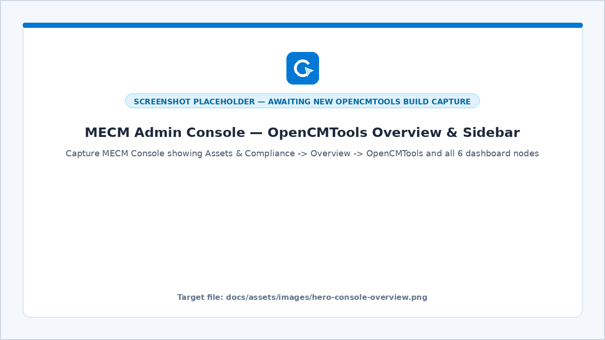

# OpenRCT — Open Source Right Click Tools for MECM

**OpenRCT** is a free, MIT-licensed, ad-free suite of **Right Click Tools** and **embedded console dashboards** for **Microsoft Configuration Manager (MECM / SCCM)**.

Manage **single devices, multiple selected devices simultaneously, or entire Device Collections** directly inside the Configuration Manager Admin Console or from the standalone Windows launcher — with zero licensing gates, zero telemetry, and zero mandatory external tool dependencies.

---

## Why OpenRCT?

- **100% Open Source & Ad-Free** — MIT licensed. No paid tiers, trial prompts, telemetry, or upsell banners.
- **Native .NET Framework 4.8 (C# / WPF)** — Runs on the exact runtime already required by the MECM Admin Console with no extra runtimes to install.
- **Zero Mandatory External Tools** — Uses native Windows and ConfigMgr interfaces (`WMI/DCOM`, `WinRM`, `SMB`, `LDAP/ADSI`, `SMS Provider`, `Wake-on-LAN`, `Remote Registry`, and `EventLogSession`). Only *Interactive Command Prompt* optionally uses user-supplied Sysinternals **PsExec**.
- **Built for Scale** — Every multi-device tool and dashboard executes concurrently with configurable concurrency and timeout limits, expandable item-first grouping, an interactive Error Drawer, and one-click CSV export.
- **Polished & Theme-Aware** — Full **Light / Dark / System** themes plus selectable **Fluent Duotone** and **Crisp Monochrome Outline** vector icons across both WPF windows and the MECM Admin Console tree/context menus.
- **Fork-Friendly** — Manual-only GitHub Releases update checks automatically resolve the repository from CI build metadata (`GITHUB_REPOSITORY`) or an optional Settings override — never hardcoded.

---

## Quick Navigation

| Section | What You'll Find |
|---|---|
| **[Installation & Upgrading](getting-started/installation.md)** | MECM 2103+ prerequisite, MSI silent install, Portable ZIP, and uninstall instructions |
| **[Standalone App](getting-started/standalone-app.md)** | Running OpenRCT outside the MECM Console against devices or collections |
| **[Settings & Customization](getting-started/settings.md)** | PsExec setup, concurrency/timeout & offline pre-check tuning, Light/Dark themes, Icon Styles, and Updates |
| **[Right-Click Tools](tools/overview.md)** | All 6 tool groups across Devices and Device Collections, including Remote Windows Security & Remote Event Viewer |
| **[Console Dashboards](dashboards/index.md)** | All 6 interactive dashboards under *Assets and Compliance → Overview → OpenRCT* |
| **[Architecture & Ports](reference/architecture.md)** | Solution layout, runtime console binding, required firewall ports, and RBAC permissions |
| **[Troubleshooting](reference/troubleshooting.md)** | Solutions for console extension visibility, WMI/WinRM/Remote Registry, LAPS, and icon sync |
| **[Hyper-V Test Lab](lab-setup/README.md)** | Automated 4-VM Hyper-V MECM lab (`LAB-DC01`, `LAB-CM01`, `LAB-WS01`, `LAB-WS02`) for safe testing |

---

## AI-Assisted Development Transparency

!!! info "Transparency Notice"
    **OpenRCT was developed with substantial AI coding assistance** under human direction, architecture review, and hands-on verification in a live Microsoft Configuration Manager test lab.

    - All code is fully open source under the MIT License for anyone to inspect, audit, fork, and improve.
    - Before deploying to production environments, administrators are encouraged to review the source code and test in a lab or pilot collection first.
    - Bug reports, code reviews, security feedback, and pull requests from the ConfigMgr community are warmly welcome — see [Building & Contributing](reference/building-and-contributing.md).
