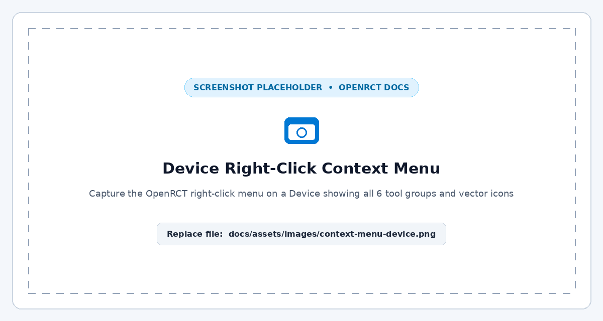

# Right-Click Tools Overview & Multi-Device UI

Right-click any **single Device**, **multiple selected Devices**, or **Device Collection** inside the Configuration Manager Admin Console and expand the **OpenRCT** menu (also mirrored on the MECM Home Ribbon).

---

## Reorganized 6-Group Menu Layout

OpenRCT groups tools logically by workflow rather than scattering remote utilities across unrelated menus:

| Menu Group | Device Menu | Device Collection Menu |
|---|---|---|
| **1. Remote Tools** | System Information, Remote Software Center, Remote Windows Security, Remote Event Viewer, Remote Registry Editor, Running Processes, Open `C$` Share, Interactive PowerShell, Interactive Command Prompt *(PsExec)*, Manage Computer | System Information, Remote Software Center, Remote Windows Security, Running Processes |
| **2. Client Actions** | All 12 ConfigMgr Client Schedules + State Message Cache Cleanup | All 12 ConfigMgr Client Schedules + State Message Cache Cleanup |
| **3. Client Tools** | Client Information, Show Collections - Advanced, Rerun Deployment, Refresh Updates Compliance State, Restart SMS Agent Host, Run Client Check, Stop Client Activities, Repair Client, Uninstall SCCM Client, Open Client Log Folder, Open Client Install Log Folder | Client Information, Restart SMS Agent Host, Run Client Check, Stop Client Activities, Refresh Updates Compliance State, Rerun Deployment, Repair Client, Uninstall SCCM Client |
| **4. Device & Power Tools** | Ping Systems, Wake on LAN, Send Notification, Schedule Restart or Shutdown, Cancel Pending Restart/Shutdown, Group Policy Update | Ping Systems, Wake on LAN, Send Notification, Schedule Restart or Shutdown, Cancel Pending Restart/Shutdown, Group Policy Update |
| **5. Security Tools** | View LAPS Password, View BitLocker Recovery Key, Defender Quick Scan, Defender Full Scan, Update Defender Definitions | View LAPS Password, View BitLocker Recovery Key, Defender Quick Scan, Defender Full Scan, Update Defender Definitions |
| **6. Active Directory & ConfigMgr** | AD Security Groups, Enable/Disable/Delete in AD, Add to Collection, Delete from ConfigMgr, Device Status Messages | Enable/Disable/Delete in AD, Device Status Messages |
| **OpenRCT Settings** | Available at the root of the OpenRCT menu | Available at the root of the OpenRCT menu |

---

## Multi-Device Expandable Item-First UI

When targeting **2 or more devices** (via multi-select or a Device Collection) in **System Information**, **Remote Software Center**, **Remote Windows Security**, or **Client Information**:

1. **Concurrent Fan-Out:** All targeted devices are queried in parallel up to your configured `MaxConcurrentDevices` setting (default `16`).
2. **Item-First Grouping:** Instead of making you pick one device at a time from a top-left dropdown, items (applications, updates, services, compliance baselines, TPM states, firewall rules, cache items, etc.) are aggregated into a single list showing **applicable device counts** and **status summaries** (e.g., `12 / 15 installed`, `8 / 8 compliant`).
3. **Expandable Applicable Devices:** Click the **`>`** chevron on any item row (or use **Expand All / Collapse All**) to inspect every applicable device underneath with resizable columns and smooth horizontal scrolling.
4. **Synced Bulk Selection:** Check the parent item checkbox to select all devices underneath it, or expand the row and check only specific devices — then click **Install**, **Uninstall**, **Repair**, **Restart Service**, **Evaluate**, **Delete**, etc. to execute in bulk.
5. **Device Filter & Flat View Toggle:** Filter to a single device from the right-aligned **Device Filter** dropdown, or toggle **Group by Item** off in System Information to inspect a flat per-device list.
6. **Error Drawer & CSV Export:** Unreachable or access-denied devices never block successful devices — failures collect neatly in the collapsible **Error Drawer**, and every table supports one-click **Export CSV**.
