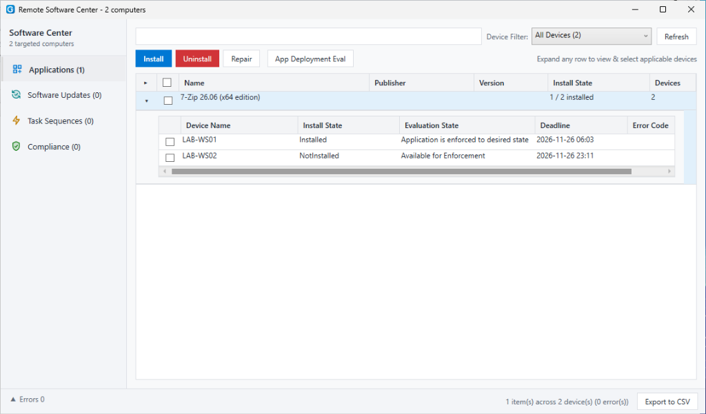
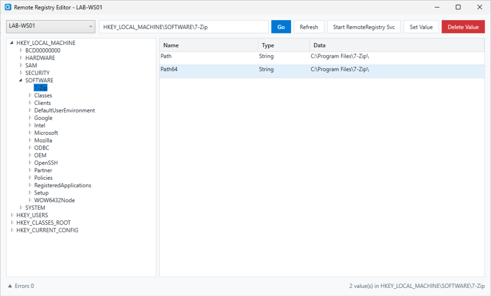

# Remote Tools

All interactive remote inspection, troubleshooting, and session tools are consolidated under **OpenRCT → Remote Tools**.

---

## System Information (Multi-Device)

Inspect and manage 10 categories of live system data across one device, multiple selected devices, or an entire Device Collection.

### Included Tabs (10)
| Tab | Data Source | Multi-Device View & Actions |
|---|---|---|
| **Operating Systems** | `Win32_OperatingSystem`, `Win32_ComputerSystem` | Side-by-side comparison across devices (OS caption, version, build, architecture, install date, last boot, logged-on user) |
| **Hardware** | `Win32_ComputerSystem`, `Win32_BIOS`, `Win32_Processor`, `Win32_OperatingSystem`, TPM | Manufacturer, model, serial number, BIOS, CPU, RAM (GB), TPM |
| **Disks** | `Win32_LogicalDisk` | Drive letter, label, filesystem, total size, free space, % free |
| **Applications** | Remote Registry `Uninstall` keys *(safe — never queries `Win32_Product`)* | Grouped by app + version; searchable; **Uninstall** selected apps across checked devices |
| **Windows Updates** | `Win32_QuickFixEngineering` | Grouped by KB ID (`HotFixId`) with description and install date |
| **Services** | `Win32_Service` | Grouped by service; **Start**, **Stop**, and **Restart** across checked devices |
| **Drivers** | `Win32_PnPSignedDriver` | Grouped by driver name, provider, version, signed state |
| **User Profiles** | `Win32_UserProfile` | Grouped/per-device profiles with **Delete Profile** action *(with confirmation; WMI errors on loaded/system profiles report to the Error Drawer)* |
| **Local Group Members** | ADSI (`WinNT://`) | Inspect `Administrators`, `Remote Desktop Users`, `Users`, `Power Users`, and `Hyper-V Administrators`; **Add / Remove Member** |
| **Batteries** | `Win32_Battery` / WMI battery status | Design capacity, full charge capacity, health %, charge state |

- **Group by Item Toggle:** On by default for multi-device views on the 6 groupable tabs (`Applications`, `Windows Updates`, `Services`, `Drivers`, `User Profiles`, `Local Group Members`); uncheck to switch to a flat list.
- **Cached Tab Loads & Refresh:** Switching tabs caches results for snappy navigation; click **Refresh** to re-query live.
- **Export to CSV:** Exports the current tab across all loaded devices.

---

## Remote Software Center (Multi-Device)

Inspect and act on Software Center deployments directly from the admin console — across single or multiple devices.

### Left Navigation Rail (4 Sections)
- **Applications** (`root\ccm\ClientSDK:CCM_Application`) — View install state (`Installed`, `Available`, `Failed`, `Installing`) and bulk **Install**, **Uninstall**, **Repair**, or trigger **App Deployment Eval** across checked devices.
- **Software Updates** (`root\ccm\ClientSDK:CCM_SoftwareUpdate`) — View available/pending/installed updates, deadline, reboot state, and trigger **Install**, **Install All Pending**, **Update Scan**, or **Update Eval** across checked devices.
- **Task Sequences** (`root\ccm\ClientSDK:CCM_Program`) — View deployed task sequences and programs; trigger **Run** across checked devices.
- **Compliance** (`root\ccm\dcm:SMS_DesiredConfiguration`) — Inspect Configuration Baselines (`Compliant`, `NonCompliant`, `Error`, `Unknown`, last eval time) and trigger **Evaluate** across checked devices.

---

## Remote Windows Security (Multi-Device, 8 Tabs)

Audit and remediate endpoint security posture across one or many devices simultaneously.

| Tab | What It Shows | Built-In Actions |
|---|---|---|
| **BitLocker** | Drive letter, protection status, encryption %, conversion status, cipher method, key protectors (`root\CIMV2\Security\MicrosoftVolumeEncryption`) | **Suspend Protection**, **Resume Protection**, **View Recovery Keys** |
| **TPM** | Spec/TCG version, Activated, Enabled, Owned, Ready, Manufacturer, Manufacturer Version, FIPS Ready, Locked Out (`root\CIMV2\Security\MicrosoftTpm`) | **Clear TPM** *(with confirmation)* |
| **Firmware** | UEFI enabled, Secure Boot state, BIOS version, **Secure Boot 2023 CA Certificate** update readiness (`WindowsUEFICA2023Capable`), status, error code, and confidence level | **Run Secure Boot Task** (`\Microsoft\Windows\PI\Secure-Boot-Update`) |
| **Virtualization-Based Security** | VBS status (`Running` / `Enabled (Not Running)` / `Not Enabled`), Credential Guard, HVCI (Memory Integrity), running & configured security services | Live refresh & CSV export |
| **Defender** | Antivirus enabled, Real-Time Protection, Antimalware Client Version, Engine Version, Signature Version, Last Signature Update, Last Quick/Full Scan (`root\Microsoft\Windows\Defender`) | **Quick Scan**, **Full Scan**, **Update Definitions** |
| **Defender Exclusions** | Configured Path, Extension, Process, and IP Address exclusions | Audit & CSV export |
| **Windows Firewall** | Domain, Private, and Public profile enabled states and default Inbound/Outbound actions *(queried from `ActiveStore` to reflect GPO/MDM overrides)* | Audit & CSV export |
| **Firewall Rules** | Display name, Action (`Allow`/`Block`), Direction (`Inbound`/`Outbound`), Profiles, Enabled state (`root\StandardCimv2:MSFT_NetFirewallRule`) | **Enable Rule**, **Disable Rule** |

---

## Remote Event Viewer

Browse and filter remote Windows Event Logs natively via `System.Diagnostics.Eventing.Reader.EventLogSession` (RPC / Event Log service) in a fast split-pane viewer.

### Key Features
- **Hierarchical Log Tree:** Left sidebar lists **Windows Logs** (`Application`, `Security`, `Setup`, `System`, `ForwardedEvents`) plus expandable **Applications and Services Logs** (`Microsoft → Windows → ...`, ConfigMgr, Defender, BitLocker, LAPS, etc.).
- **Auto-Applying Filter Bar (Server-Side XPath + Client-Side Search):**
  - **Device** selector (when multiple devices are targeted)
  - **Severity (XPath):** `All`, `Critical`, `Error`, `Critical & Error`, `Warning`, `Information`, `Verbose`
  - **Event ID(s) (XPath):** Single ID or comma-separated list (e.g., `1000, 7036, 4625`)
  - **Start / End Date (XPath):** Range pickers converted to UTC XPath `TimeCreated`
  - **Max Entries:** Numeric input (default **`200`**, range `10`–`2000`)
  - **Source (client-side):** Substring filter on event provider/source name
  - **Keyword (client-side):** Search across message text, source, task category, and ID
- **Pagination:** Clean `Previous` / `Page N` / `Next` paging for responsive browsing.
- **Detail Pane:** Toggle between formatted **General** message view and raw **XML View**, with **Copy Event Details** and **Export CSV**.

---

## Remote Registry Editor

Native WPF remote registry explorer built on `Microsoft.Win32.RegistryKey.OpenRemoteBaseKey` (requires the **Remote Registry** service on the target endpoint; respects the **Fast Offline Pre-Check** setting).

- Browse `HKEY_LOCAL_MACHINE`, `HKEY_USERS`, `HKEY_CLASSES_ROOT`, and `HKEY_CURRENT_CONFIG`.
- Lazy-expanding tree with instant path jump bar (`HKLM\`, `HKU\`, `HKCR\`, `HKCC\`), value type/data display (`String`, `ExpandString`, `DWord`, `QWord`, `Binary`, `MultiString`), **Set Value** (create/edit), **Delete Value** *(with confirmation)*, and a one-click **Start RemoteRegistry Svc** helper button.

---

## Additional Remote Tools

- **Running Processes:** Live view of remote processes (`Device`, `PID`, `Process Name`, `Memory (MB)`, `Started`, `Command Line`) with bulk **Terminate Selected** across single or multiple devices.
- **Connect to `C$` *(single device)*:** Opens `\\<device>\C$` directly in Windows File Explorer.
- **Interactive PowerShell Prompt *(single device)*:** Launches an interactive WinRM PowerShell remoting session (`Enter-PSSession -ComputerName <device>`).
- **Interactive Command Prompt *(Optional PsExec, single device)*:** Launches an interactive remote `cmd.exe` session using your configured Sysinternals `PsExec.exe` / `PsExec64.exe` path in [Settings](../getting-started/settings.md).
- **Manage Computer *(single device)*:** Launches Microsoft Computer Management (`compmgmt.msc /computer:\\<device>`).
